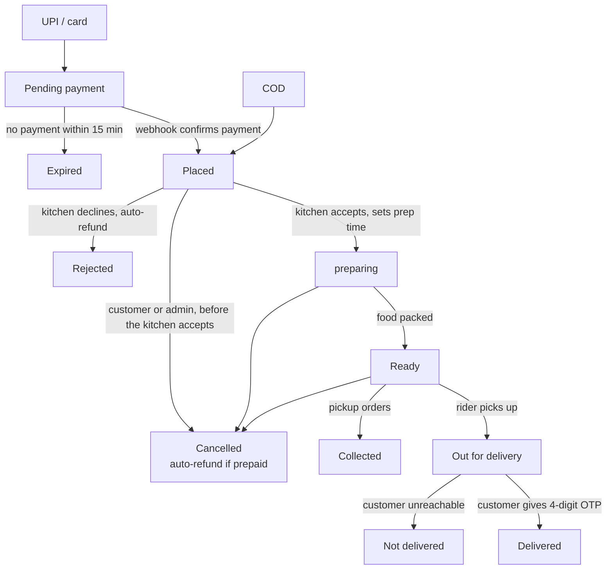

# Restaurant Delivery Web App — Technical Blueprint

Generated from `docs/source.md`.

One Next.js website, two Flutter apps, one Express API and one BullMQ worker. The server side runs on a single GCP Compute Engine VM in Mumbai, with MongoDB Atlas in the same region; that comfortably carries one restaurant's peak.

## Stack

| Layer           | Choice                                                                                                   | Why                                                                                                                      |
| --------------- | -------------------------------------------------------------------------------------------------------- | ------------------------------------------------------------------------------------------------------------------------ |
| Language        | TypeScript (strict), ESM                                                                                 | The price calculator and order-status rules are shared by web and API; types stop them drifting apart                    |
| Web             | Next.js App Router + Tailwind                                                                            | SSR menu for Google and WhatsApp previews; serves the ordering website and the admin                                     |
| API             | Express 5 + Mongoose + zod                                                                               | Socket.io and BullMQ need a long-running process; your comfort zone                                                      |
| Database        | MongoDB Atlas, Mumbai region                                                                             | Menu items with nested variants and order snapshots are natural documents; managed backups                               |
| Queue / cache   | Redis + BullMQ, separate worker process                                                                  | Payment expiry, escalations and WhatsApp retries can't live in request handlers                                          |
| Realtime        | Socket.io + Redis adapter                                                                                | Kitchen board, tracking and rider location; the adapter makes a second API process a config change                       |
| Auth            | Custom JWT: 15-min access + 30-day rotating refresh (httpOnly cookie on web, secure storage in the apps) | Phone OTP only, no passwords                                                                                             |
| OTP and updates | WhatsApp Business API; MSG91 SMS fallback for OTP only                                                   | You already run WhatsApp; customers read it, not SMS                                                                     |
| Maps            | Google Places Autocomplete + Maps JS                                                                     | Pin drop beats typed addresses in Punjab towns; zone check is haversine, so there's no per-checkout Distance Matrix bill |
| Payments        | Razorpay Standard Checkout, webhooks, Refunds API                                                        | UPI-first; refunds automated                                                                                             |
| Images          | Local upload, sharp → WebP at 3 widths, served by Nginx                                                  | Your default; no Cloudinary bill                                                                                         |
| Monitoring      | Sentry (web, API and both apps) + an uptime ping on /health                                              |                                                                                                                          |

## Flutter apps

- Two apps, `apps/customer_app` (Android + iOS) and `apps/partner_app` (Android; kitchen or rider by login role), on the latest stable Flutter, **outside the pnpm workspace**.
- Riverpod, go_router and Dio, with freezed models generated from the API's OpenAPI spec (`GET /openapi.json`) so the Dart types can't drift from the zod schemas.
- **The apps never compute prices:** they call `POST /cart/quote` and show what the server returns.
- Auth: the apps send `X-Client: app`, so the API returns the refresh token in the response body instead of a cookie; the apps keep it in secure storage.
- Push is Firebase Cloud Messaging. The Partner app gets high-priority data messages on its own alarm-sound channel; Socket.io carries live updates while an app is open.
- Maps: google_maps_flutter for the address pin and the rider marker; geolocator with an Android foreground service for rider location during a delivery.
- Payments: razorpay_flutter, same server flow as the website. Food is a physical good, so Apple's in-app purchase rules don't apply.
- Distribution: customer app on the Play Store and App Store; Partner app as a private APK on staff devices, with no store listing.

## Repo layout

```
restaurant-app/
  apps/
    web/                 Next.js App Router
      app/(store)/       menu, cart, checkout, track, account
      app/(admin)/admin/
    api/                 Express 5
      src/modules/       auth, menu, orders, payments, delivery,
                         coupons, riders, reports, settings, notifications
      src/jobs/          BullMQ processors (run by worker.ts)
      src/sockets/
    customer_app/        Flutter, Android + iOS
    partner_app/         Flutter, Android: kitchen + rider by role
  packages/
    shared/              zod schemas, ORDER_STATUS + transitions, pricing.ts
  docs/                  PRD.md, BLUEPRINT.md, RUNBOOK.md
  ecosystem.config.cjs   PM2: web, api, worker
```

The Session 0 scaffold still has placeholder `(kitchen)` and `(rider)` route groups in `apps/web`; Session 5 deletes them, because those screens live in the Partner app.

`packages/shared/pricing.ts` is the only place a total is computed. The cart uses it for display, and the API uses it as the authority. The Flutter apps get their totals from `POST /cart/quote` instead. A total sent by any client is never trusted.

## Deployment

- A GCP project for this client, separate from AnyImmi's, with a budget alert.
- One Compute Engine VM, e2-standard-2 in asia-south1 (Mumbai), running Ubuntu LTS with a static IP, Nginx, PM2, Redis and Let's Encrypt. Not Cloud Run: Socket.io and the BullMQ worker need always-on processes, and Cloud Run would add minimum instances, sticky sessions and managed Redis for no gain at this size.
- MongoDB Atlas on GCP, in the Mumbai region.
- Nginx serves the website on `/`, the API on `/api`, the Socket.io upgrade, and `/uploads` as static files. One domain means no CORS or cookie headaches.
- Hostinger keeps the DNS (A records to the VM's static IP).
- Staging is a second small VM with Razorpay test keys and a staging Firebase project.
- Backups: Atlas daily snapshots, plus a nightly tar of `/uploads` to a Cloud Storage bucket, kept 14 days.
- Maps keys, one per platform: the web key is locked to the domain, the Android keys to package name + SHA-1, the iOS key to the bundle ID, and a server key (only if the API geocodes) to the VM's IP. Enable only the APIs in use, each with a daily quota cap.

## Data model

Eight collections. Orders snapshot every item, price and the address at placement, so later menu edits never change a past order or its invoice.

| Collection  | Key fields                                                                                                                                                                                                                                                                                                                                                                      | Notes                                                             |
| ----------- | ------------------------------------------------------------------------------------------------------------------------------------------------------------------------------------------------------------------------------------------------------------------------------------------------------------------------------------------------------------------------------- | ----------------------------------------------------------------- |
| outlets     | name, address, geo (Point), phone, hours[], holidays[], acceptingOrders, feeSlabs[{upToKm, fee}], minOrder, freeDeliveryAbove, packagingCharge, gst {gstin, rate}, fssaiNo, codMax                                                                                                                                                                                              | One document in v1; `outletId` everywhere keeps multi-outlet open |
| categories  | outletId, name, sortOrder, timeWindows[], isActive                                                                                                                                                                                                                                                                                                                              | Time windows allow a breakfast-only category                      |
| menuItems   | outletId, categoryId, name, description, images{320,640,1280}, isVeg, basePrice, variants[{name, price}], addonGroups[{name, min, max, options[{name, price, isVeg}]}], isAvailable, tags[], sortOrder                                                                                                                                                                          | Prices in paise (integers) everywhere                             |
| users       | phone (unique), name, role (customer, staff, rider, admin), addresses[{label, line, landmark, geo, isDefault}], codDisabled, isBlocked, marketingOptIn {at}, devices[{fcmToken, app, platform, lastSeenAt}]                                                                                                                                                                     | One collection for all roles                                      |
| orders      | orderNo, outletId, customerId, type (delivery, pickup), items[] snapshot, pricing {subtotal, discount, packaging, deliveryFee, tax, roundOff, total}, address snapshot, payment {method, status, razorpayOrderId, razorpayPaymentId, refundId}, status, statusHistory[{status, at, by, reason}], prepMinutes, riderId, deliveryOtp, couponCode, rating, idempotencyKey (unique) | Payment status is a separate field from order status              |
| coupons     | code, type (flat, percent), value, maxDiscount, minOrder, firstOrderOnly, perUserLimit, totalLimit, usedCount, validFrom, validTo                                                                                                                                                                                                                                               | Usage incremented in the same transaction as order creation       |
| otpSessions | phone, codeHash, attempts, sendsInWindow, expiresAt                                                                                                                                                                                                                                                                                                                             | TTL index on expiresAt                                            |
| auditLogs   | actor, action, entity, before, after, at                                                                                                                                                                                                                                                                                                                                        | Price changes, refunds, coupon edits, cancellations               |

Live rider location lives only in Redis (one key per active order, 30-min TTL). Writing it to Mongo every 10 seconds buys nothing.

Indexes: orders `{outletId, createdAt}`, `{customerId, createdAt}`, `{status, createdAt}`; menuItems `{outletId, categoryId, sortOrder}`; users `phone` unique; coupons `code` unique.

## Order lifecycle

Before the kitchen accepts, the customer or an admin can also cancel a placed order, with an automatic refund; after that, the customer can't cancel, and only the restaurant (staff or admin) can. Rejected and cancelled prepaid orders refund automatically.



In code the accepted state is named `preparing` (there is no separate `accepted` status).

| From             | To               | Trigger                                                               |
| ---------------- | ---------------- | --------------------------------------------------------------------- |
| (UPI/card)       | pending_payment  | Order created with online payment                                     |
| pending_payment  | placed           | Webhook confirms payment                                              |
| pending_payment  | expired          | No payment within 15 min                                              |
| (COD)            | placed           | Order created with COD                                                |
| placed           | preparing        | Kitchen accepts, sets prep time                                       |
| placed           | rejected         | Kitchen declines with a reason; auto-refund if prepaid                |
| placed           | cancelled        | Customer or admin, before the kitchen accepts; auto-refund if prepaid |
| preparing        | ready            | Food packed                                                           |
| preparing, ready | cancelled        | Restaurant or admin (never the customer); auto-refund if prepaid      |
| ready            | collected        | Pickup orders                                                         |
| ready            | out_for_delivery | Rider picks up                                                        |
| out_for_delivery | delivered        | Customer gives 4-digit OTP                                            |
| out_for_delivery | not_delivered    | Customer unreachable                                                  |

Cancel permissions live in `CANCELLABLE_BY` / `canCancel()` and auto-refund targets in `AUTO_REFUND_STATUSES` (`packages/shared/src/order-status.ts`).

Payment status (pending, paid, refunded) is a separate field, so a refund never hides where the order stopped. Clients only request a move; `orders.transition()` checks it against this map and the caller's role.

## Payments, delivery, realtime and security

The Razorpay webhook decides whether an order is paid. Only the server's transition function changes an order's status. Everything below follows from those two rules.

### Payments

1. Checkout sends the cart, the address, the payment method and an idempotency key. The API re-reads every item from the database and recomputes the total with `pricing.ts`.
2. For online payment, the API creates the order as `pending_payment` plus a Razorpay order for the exact amount in paise. The client then opens Razorpay Checkout (web) or razorpay_flutter (apps).
3. The client's success handler calls `/payments/verify` (fast path). The `payment.captured` webhook is the source of truth, and both paths are idempotent.
4. A job expires unpaid orders after 15 minutes. If a capture arrives after expiry, it is refunded automatically.
5. A reject or cancel on a paid order calls the Refunds API, and the `refund.processed` webhook closes it out.

COD requires a verified phone and a total under the outlet's `codMax`. Admin can switch COD off for a customer after one fake order.

### Delivery zones and fees

- The zone check is the straight-line (haversine) distance from the outlet to the customer's pin, matched against fee slabs, for example 0–3 km and 3–6 km. Beyond the last slab, the customer gets pickup only.
- Road distance runs longer than straight-line, so set the slabs a little tighter than the real riding radius. Switch to road distance in v2 only if fee disputes show up.
- ETA shown = the accepted prep time + a per-km riding estimate.

### Realtime and background jobs

- Socket.io rooms: `outlet:<id>` (kitchen and admin), `order:<id>` (customer tracking), `rider:<id>`. Sockets authenticate at handshake. The server only emits; all changes go through REST.
- Rider location: the Partner app sends its position every 10 s during an active delivery, from a foreground service so it keeps going with the phone locked. It goes to Redis (30-min TTL) and is emitted to the order's room.
- BullMQ queues, run by a separate worker process:
  - `payments`: expire unpaid orders at 15 min
  - `escalations`: WhatsApp the owner if an order isn't accepted by 2 min, and again at 5 min
  - `notifications`: WhatsApp sends with retry
  - `reports`: nightly sales summary to the owner

### Kitchen alert reliability

This is the feature that loses or keeps the client.

- Every new order goes out twice: a Socket.io event for the open app, and a high-priority FCM message that wakes the tablet when the app is in the background or the screen is off.
- The Partner app plays it on its own notification channel with a loud alarm that repeats until someone accepts, and keeps the screen awake on the kitchen view.
- The tablet stays plugged in, with battery optimisation turned off for the Partner app; Kirandeep sets this at install, because otherwise Android can delay pushes.
- If the tablet or the Wi-Fi is dead, the WhatsApp escalation to the owner at 2 minutes still fires.

### WhatsApp templates

Submit these for Meta approval in week 1, because approval can take days: OTP (authentication), order confirmed, accepted with ETA, out for delivery with the tracking link, delivered with a rating link, rejected or cancelled with a refund note.

### Security

- OTP: 6 digits, stored hashed, 5-minute expiry, 5 attempts, 3 sends per phone per 15 minutes, plus a per-IP limit.
- Refresh tokens rotate on each use; reusing an old token revokes the whole family. Web gets the refresh token as an httpOnly cookie; requests with `X-Client: app` get it in the response body.
- Role guard on every route; a rider can only read orders assigned to them.
- Every route registers its request and response schemas with OpenAPI (`@asteasolutions/zod-to-openapi`, served at `GET /openapi.json`).
- helmet; CORS locked to the domain; zod on every request body; rate limits on `/auth` and `/orders`.
- Uploads are admin-only, capped at 5 MB, MIME-sniffed and re-encoded by sharp, which strips EXIF and anything embedded.
- The webhook verifies the Razorpay signature on the raw body.
- Audit log on price changes, refunds and coupon edits.
